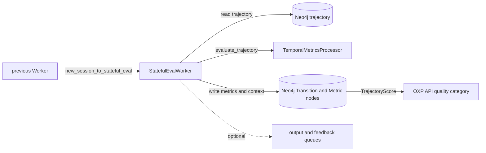

# Stateful Eval Worker

The Stateful Eval worker scores agent sessions with the
[Stateful Evals](../../stateful-evals/README.md) library. It takes a session ID
from a RabbitMQ queue, reads the session's normalized trajectory (the
LLM, tool, and agent calls, with their `Transition` and `State` nodes)
from the Neo4j knowledge graph, and evaluates it in process with
`stateful_evals_be.TemporalMetricsProcessor`. It writes per-step Groundedness,
IntentRecognition, and Relevancy scores, the trajectory context each step
contributed, and a session `TrajectoryScore` back to the knowledge graph, then
forwards the message. No OTel store is read.
Evaluation makes model calls, which can cost money. The worker is built on the
[worker-base](../../worker-base/README.md) framework.

## Where it sits in OXP



The OXP API's `quality` category reads `TrajectoryScore` as a source of `MDT` (`trajectoryQuality`) in [`config.py`](../../api/oxp/core/config.py); no default
category lists the step metrics (`Groundedness`, `IntentRecognition`, `Relevancy`) under the `StatefulEvals` provider.

## How it works

For each message, `StatefulEvalWorker.handle_message`:

1. Reads the trajectory with the OXP API library's
   `oxp.client.dal.get_session_trajectory`: every `LLMCall`, `ToolCall`, and `AgentCall` of the session, in start-time order, with the `Transition` it corresponds to and the text of its initial and final `State`, in one query.
   Builds a new `TemporalMetricsProcessor` and calls
   `evaluate_trajectory(trajectory)`. Steps are identified by their KG ids;
   there is no span id or de-duplication. The policy is the first LLM call's system prompt, the request is its first
   user message, and each agent's own system prompt is recorded as its contract. No policy override is passed.
2. Judges each LLM and tool step against the context built from the steps
   before it, then runs the final trajectory audit.
3. Writes the results to Neo4j when `PUSH_METRICS` is on and `result.error` is
   empty.
4. Publishes one output message to each output queue.

Reading, evaluation, and writes run in threads. Up to `MAX_INFLIGHT_MESSAGES`
messages run at once and share the base worker's Neo4j connector. The processor
returns its errors in `result.error` (for example `No trajectory steps found for
session`); the worker then writes nothing but still publishes. If reading or
writing raises, the worker logs it, sends an `error` feedback event, and
publishes nothing. Either way the message is acknowledged, not requeued.

## Messages

| Direction | Queue | Payload |
| --- | --- | --- |
| Consumes | `new_session_to_stateful_eval` (durable) | `BaseQueueMessage`: `session_id` (required), `job_id`, `workflow_id`, `local_file` (passed through, not read). Other fields are ignored |
| Publishes | Each output queue; none by default | `BaseQueueMessage` with `job_id`, `workflow_id`, `local_file`, and `session_id` copied from the input |
| Feedback | Feedback queue; none by default | `session_id`, `event` (`start`, then `complete` or `error`), `workflow` (`StatefulEvalWorker`), `workflow_id`; `start` adds `input` and `queue_name` |

## What it writes

The worker reads and writes Neo4j only, through the shared connector
(`oxp.dependencies.get_neo4j_connector()`).

| Written | Attached to | Value |
| --- | --- | --- |
| `Groundedness`, `IntentRecognition`, `Relevancy` | `(:MetricResult)-[:measures]->(:LLMCall\|:ToolCall)`, matched by the call's id; written only if the call exists | `0`, `0.25`, `0.5`, `0.75` or `1` per judged LLM or tool step (1-5 rubric normalized to `(score-1)/4`); tool steps get no Groundedness |
| `TrajectoryContext` node | `(:Transition)-[:hasContext]->(:TrajectoryContext {id, evidence, claims, ...})`, one per step (`PUSH_TRANSITION_CONTEXT`) | one JSON property per constituent: what the step added to the trajectory context (see below) |
| `TrajectoryScore` | `(:MetricResult)-[:measures]->(:Session {sessionId})`; nothing is written if there is no such session | `0` or `1`; `reasoning` is `trajectory_reasoning` |

Each value is a `MetricResult` node (`result`, `reasoning`, `timestamp`) linked by `ofMetricType` to a
`Metric` definition (one per name and provider, here `metricProvider` `StatefulEvals`) and by `measures` to what it
measures. A result is keyed by definition and measured resource, so a re-run overwrites it. `Span` nodes are not
written.

### `TrajectoryContext`

A `TrajectoryContext` node (a semantic-ontology class) has one JSON property per
constituent, present only when the step contributed it: `evidence`, `claims`,
`coordinationEvents`, `provenanceLinks` and `flags` (new items with their
absolute `index`), `intents` and `workUnits` (new or changed items, keyed by
`index`), and `finalAnswer` (the answer text). Context that exists before the
first step (policy, root request, agent contracts) is part of the first
transition's node, and the context finalized after the last step part of the
last one. The node's id is derived from its transition's and its properties are
replaced, so a re-run overwrites it. Applying the nodes in step order rebuilds
the context at any step.

## Configuration

Flags override environment variables, except `MAX_INFLIGHT_MESSAGES`, which
overrides `--max-inflight-messages`. From a source checkout, `cli.py` also loads
`workers/stateful-eval-worker/.env`, without overriding variables already set.

| Variable | Flag | Default | Purpose |
| --- | --- | --- | --- |
| `RABBITMQ_URL` | `--rabbitmq-url` | none | Broker URL; this or the split variables are required, also with `--run-once` |
| `RABBITMQ_HOST`, `RABBITMQ_USER`, `RABBITMQ_PASSWORD`, `RABBITMQ_PORT`, `RABBITMQ_VHOST` | | none, none, none, `5672`, `/` | Alternative to `RABBITMQ_URL`; host, user, and password are required |
| `STATEFUL_EVAL_INPUT_QUEUE` | `--input-queue` | `new_session_to_stateful_eval` | Input queue (`queues.NEW_SESSION_TO_STATEFUL_EVAL_Q`) |
| `STATEFUL_EVAL_OUTPUT_QUEUE` | `--output-queue` (repeatable) | none | Output queues, comma-separated |
| `STATEFUL_EVAL_FEEDBACK_QUEUE` | `--feedback-queue` | none | Feedback queue |
| `MAX_INFLIGHT_MESSAGES` | `--max-inflight-messages` | `32` | Concurrent messages and prefetch count; `-1` uses the CPU count |
| `OPENAI_API_KEY` | `--llm-api-key` | empty | Model API key |
| `LLM_MODEL_NAME` | `--llm-model-name` | `gpt-4o` | Judge model |
| `LLM_BASE_MODEL_URL_MCE` | `--llm-base-model-url` | `https://api.openai.com/v1` | Model endpoint |
| `SAMPLING_STRATEGY`, `SAMPLING_EARLY_RATE`, `SAMPLING_MID_RATE` | | `none`, `0.25`, `0.60` | `tail_weighted` judges these shares of spans in the first 40% and the next 30%; the rest and anchor spans are always judged |
| `PUSH_METRICS` | | `true` | `false`, `0`, or `no` skips all Neo4j writes (the trajectory is still read) |
| `PUSH_TRANSITION_CONTEXT` | | `true` | `false`, `0`, or `no` skips writing `TrajectoryContext` nodes |
| `NEO4J_HOST`, `NEO4J_PORT`, `NEO4J_USERNAME`, `NEO4J_PASSWORD`, `NEO4J_DATABASE` | | `localhost`, `7687`, `neo4j`, empty, `neo4j` | Knowledge graph, read and written. `NEO4J_AUTH=user/password` also sets the credentials |

The connector is `oxp.dependencies.get_neo4j_connector()`, the one `BaseWorker`
creates at startup and every other worker uses, so the worker does not close it.
It reads `NEO4J_URI` first, else `NEO4J_HOST`, which may be a bare host,
`host:port`, or a URI, and uses `NEO4J_PORT` when the host has no port.

## Run locally

From the repository root:

```bash
# Liveness check: prints "I'm Alive"
uv run --package stateful-eval-worker stateful-eval-worker-cli --test

# Queue mode
uv run --package stateful-eval-worker stateful-eval-worker-cli \
  --rabbitmq-url amqp://<user>:<password>@localhost:5672/ --output-queue <next-queue>

# Run-once mode (Argo Workflows): --input to --output, no broker connection
echo '{"session_id": "<session-id>"}' > /tmp/stateful-eval-input.json
uv run --package stateful-eval-worker stateful-eval-worker-cli --run-once \
  --rabbitmq-url amqp://<user>:<password>@localhost:5672/ \
  --input /tmp/stateful-eval-input.json --output /tmp/stateful-eval-output.json
```

`--run-once` writes `{"workflow_id": ..., "session_id": ...}` to `--output` and
generates `workflow_id` when the input has none. `--input` also accepts inline
JSON; a JSON array is processed as a batch and written as an array. In queue
mode, `--max-sessions N` processes at most N messages (`-1`, the default, means
no limit).

## Docker

Build from the repository root.

```bash
docker build -f workers/stateful-eval-worker/deploy/docker/Dockerfile \
  -t stateful-eval-worker .
docker run --rm stateful-eval-worker --test
```

`entrypoint.sh` passes the container arguments to `stateful-eval-worker-cli`,
or the `INPUT_WORKFLOW` string when there are none, and prints the `--input`
file to the log. `docker compose up stateful-eval` also starts RabbitMQ
and Neo4j. Compose sets `NEO4J_HOST`
to `neo4j:7687` and `NEO4J_URI` to `bolt://neo4j:7687`, which the shared
connector resolves to `bolt://neo4j:7687`.

## Tests

```bash
uv run --package stateful-eval-worker --extra dev pytest workers/stateful-eval-worker/tests -v
```

The tests mock the KG connector and the processor. They need no
broker, database, or model.

## Related pages

- [Stateful Evals](../../stateful-evals/README.md): library usage, options, and `SessionResult`
- [Quickstart](../../stateful-evals/quickstart/README.md): the bundled NOA trip planner trajectory
- [Trajectory Context](../../stateful-evals/stateful_evals_be/evaluation/README.md): the state built for each trajectory
